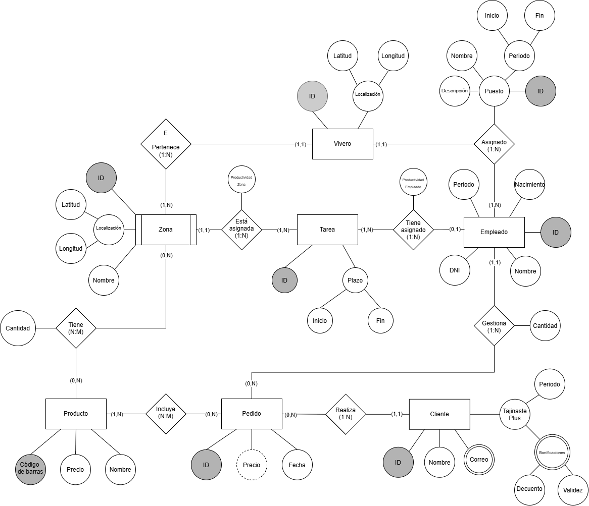
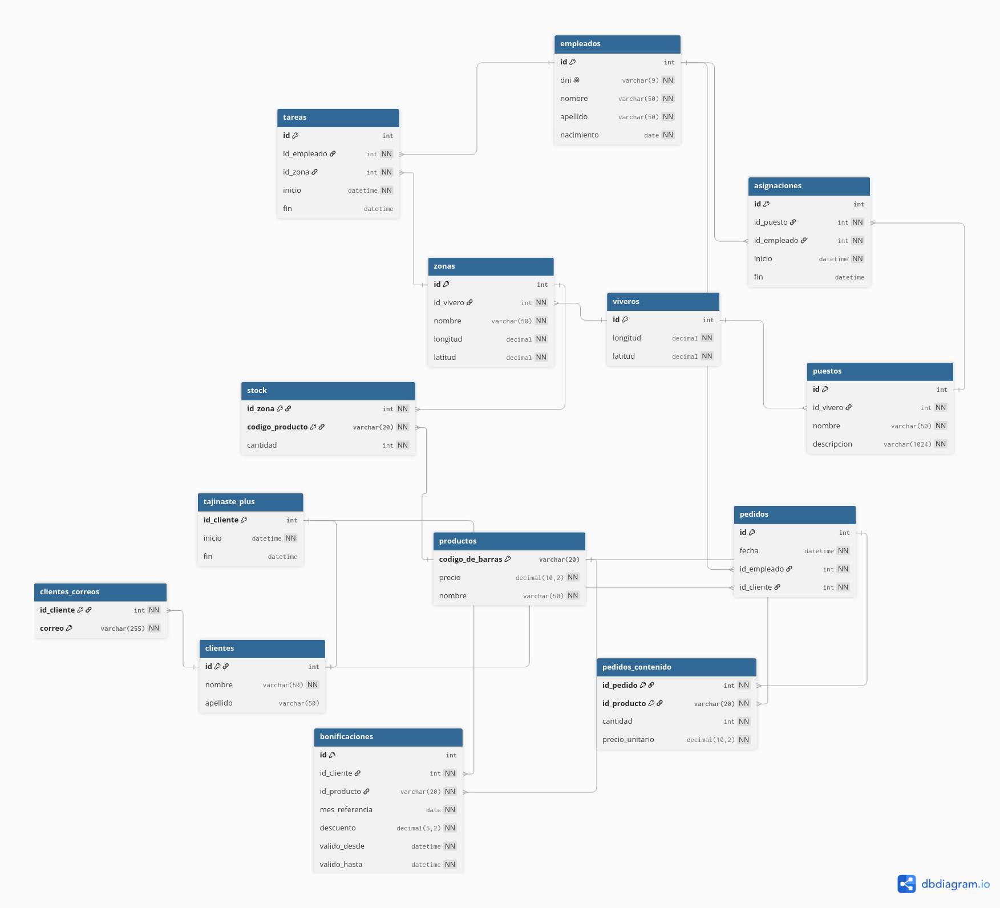

# Práctica 3: Base de datos de viveros

Diseño e implementación en PostgreSQL del modelo relacional de Tajinaste S.A.
Incluye tablas, claves y restricciones de integridad, datos de prueba, vistas para
atributos derivados y ejemplos de operaciones `DELETE`.

## Diagramas





## Ejecución

Ejecuta el script desde `psql`, conectado a una base de datos distinta de `viveros` y con permisos para crear bases de datos y la extensión `btree_gist`:

```bash
psql -U postgres -d postgres -f init.sql
```

El script ha sido generado con dbdiagram.io a partir del diagrama y ajustado por ChatGPT para incluir restricciones que no se puede representar en el modelo relacional.

## Consultas SELECT

Ejemplos para consultar todas las tablas del modelo:

```sql
SELECT * FROM viveros;
```

```
 id |  longitud  |  latitud
----+------------+-----------
  1 | -16.315000 | 28.487000
  2 | -16.250000 | 28.463000
  3 | -16.410000 | 28.480000
  4 | -16.520000 | 28.390000
  5 | -16.680000 | 28.090000
(5 rows)

```

---

```sql
SELECT * FROM zonas;
```

```
 id | id_vivero |   nombre    |  longitud  |  latitud
----+-----------+-------------+------------+-----------
  1 |         1 | Exterior    | -16.315100 | 28.487100
  2 |         2 | Almacén     | -16.250100 | 28.463100
  3 |         3 | Invernadero | -16.410100 | 28.480100
  4 |         4 | Exposición  | -16.520100 | 28.390100
  5 |         5 | Sombra      | -16.680100 | 28.090100
(5 rows)
```

---

```sql
SELECT * FROM empleados;
```

```
 id |    dni    | nombre | apellido  | nacimiento
----+-----------+--------+-----------+------------
  1 | 12345678Z | Ana    | Hernández | 1988-04-12
  2 | 87654321X | Carlos | Pérez     | 1990-09-23
  3 | 23456789D | Lucía  | González  | 1985-02-08
  4 | 34567890A | Mario  | Díaz      | 1995-11-17
  5 | 45678901R | Elena  | Rodríguez | 1992-06-30
(5 rows)
```

---

```sql
SELECT * FROM puestos;
```

```
 id | id_vivero |   nombre   |                     descripcion
----+-----------+------------+-----------------------------------------------------
  1 |         1 | Jardinería | Mantenimiento y cuidado de las plantas de exterior.
  2 |         2 | Almacén    | Recepción, organización y reposición de productos.
  3 |         3 | Producción | Cuidado y control de plantas de invernadero.
  4 |         4 | Ventas     | Atención a clientes y asesoramiento comercial.
  5 |         5 | Encargado  | Coordinación de las operaciones del vivero.
(5 rows)
```

---

```sql
SELECT * FROM asignaciones;
```

```
 id | id_puesto | id_empleado |       inicio        |         fin
----+-----------+-------------+---------------------+---------------------
  1 |         1 |           1 | 2023-01-01 00:00:00 | 2024-01-01 00:00:00
  2 |         2 |           1 | 2024-01-01 00:00:00 |
  3 |         3 |           2 | 2025-01-01 00:00:00 |
  4 |         4 |           3 | 2023-02-01 00:00:00 | 2024-01-01 00:00:00
  5 |         4 |           3 | 2024-01-01 00:00:00 |
  6 |         5 |           4 | 2024-04-01 00:00:00 |
  7 |         1 |           5 | 2025-09-01 00:00:00 |
(7 rows)
```

---

```sql
SELECT * FROM tareas;
```

```
 id | id_asignacion | id_zona |       inicio        |         fin
----+---------------+---------+---------------------+---------------------
  1 |             1 |       1 | 2023-06-01 08:00:00 | 2023-06-10 16:00:00
  2 |             2 |       2 | 2026-10-01 09:00:00 |
  3 |             3 |       3 | 2025-11-01 08:00:00 | 2025-11-02 16:00:00
  4 |             4 |       4 | 2023-05-01 08:00:00 | 2023-05-03 16:00:00
  5 |             5 |       4 | 2025-05-01 08:00:00 | 2025-05-02 16:00:00
  6 |             6 |       5 | 2025-06-01 08:00:00 | 2025-06-02 16:00:00
  7 |             7 |       1 | 2025-11-01 08:00:00 | 2025-11-03 16:00:00
(7 rows)
```

---

```sql
SELECT * FROM productos;
```

```
 codigo_de_barras | precio |       nombre
------------------+--------+--------------------
 8410000000001    |  12.50 | Maceta de barro
 8410000000002    |   5.99 | Sustrato universal
 8410000000003    |  21.00 | Rosal
 8410000000004    |  35.50 | Olivo joven
 8410000000005    |   8.90 | Abono orgánico
(5 rows)
```

---

```sql
SELECT * FROM stock;
```

```
 id_zona | codigo_producto | cantidad
---------+-----------------+----------
       1 | 8410000000001   |       25
       1 | 8410000000002   |        0
       2 | 8410000000003   |       18
       3 | 8410000000004   |        7
       4 | 8410000000001   |       12
       5 | 8410000000005   |       31
       5 | 8410000000002   |        4
(7 rows)
```

---

```sql
SELECT * FROM clientes;
```

```
 id |      nombre       | apellido
----+-------------------+----------
  1 | Beatriz           | Suárez
  2 | Daniel            | Méndez
  3 | Irene             | Padrón
  4 | Pablo             | León
  5 | Sara              | Cabrera
  6 | Cliente ocasional |
(6 rows)
```

---

```sql
SELECT * FROM clientes_correos;
```

```
 id_cliente |        correo
------------+-----------------------
          1 | beatriz@example.test
          1 | b.suarez@example.test
          2 | daniel@example.test
          3 | irene@example.test
          4 | pablo@example.test
          5 | sara@example.test
(6 rows)
```

---

```sql
SELECT * FROM tajinaste_plus;
```

```
 id_cliente |       inicio        |         fin
------------+---------------------+---------------------
          1 | 2024-01-01 00:00:00 |
          2 | 2024-05-01 00:00:00 | 2026-01-01 00:00:00
          3 | 2025-01-01 00:00:00 |
          4 | 2025-03-01 00:00:00 |
          5 | 2024-01-01 00:00:00 | 2026-04-01 00:00:00
(5 rows)
```

---

```sql
SELECT * FROM pedidos;
```

```
 id |        fecha        | id_empleado | id_cliente
----+---------------------+-------------+------------
  1 | 2025-11-15 10:30:00 |           1 |          1
  2 | 2025-11-20 12:15:00 |           2 |          2
  3 | 2026-02-10 09:45:00 |           3 |          3
  4 | 2026-03-01 14:20:00 |           5 |          6
  5 | 2026-06-01 11:00:00 |           4 |          5
  6 | 2025-04-05 16:05:00 |           3 |          4
(6 rows)
```

---

```sql
SELECT * FROM pedidos_contenido;
```

```
 id_pedido |  id_producto  | cantidad | precio_unitario
-----------+---------------+----------+-----------------
         1 | 8410000000001 |        2 |           12.50
         1 | 8410000000002 |        1 |            5.99
         2 | 8410000000003 |        3 |           21.00
         3 | 8410000000004 |        1 |           35.50
         3 | 8410000000001 |        1 |           12.50
         4 | 8410000000002 |        2 |            5.75
         5 | 8410000000005 |        1 |            8.90
         6 | 8410000000003 |        1 |           20.95
         6 | 8410000000002 |        2 |            5.99
(9 rows)
```

---

```sql
SELECT * FROM bonificaciones;
```

```
 id | id_cliente |  id_producto  | mes_referencia | descuento |    valido_desde     |    valido_hasta
----+------------+---------------+----------------+-----------+---------------------+---------------------
  1 |          1 | 8410000000001 | 2025-10-01     |     10.00 | 2025-11-01 00:00:00 | 2025-12-01 00:00:00
  2 |          2 | 8410000000003 | 2025-10-01     |      5.00 | 2025-11-01 00:00:00 | 2025-12-01 00:00:00
  3 |          3 | 8410000000004 | 2026-01-01     |     12.50 | 2026-02-01 00:00:00 | 2026-03-01 00:00:00
  4 |          4 | 8410000000002 | 2025-03-01     |      8.00 | 2025-04-01 00:00:00 | 2025-05-01 00:00:00
  5 |          5 | 8410000000005 | 2026-03-01     |     15.00 | 2026-03-01 00:00:00 | 2026-04-01 00:00:00
(5 rows)
```

---

### Vistas de atributos derivados

El importe de los pedidos y el volumen mensual de compras de los clientes Tajinaste Plus se calculan mediante estas vistas:

```sql
SELECT *
FROM vista_pedidos_totales
ORDER BY id_pedido;
```

```
 id_pedido |        fecha        | id_empleado | id_cliente | importe_total
-----------+---------------------+-------------+------------+---------------
         1 | 2025-11-15 10:30:00 |           1 |          1 |         30.99
         2 | 2025-11-20 12:15:00 |           2 |          2 |         63.00
         3 | 2026-02-10 09:45:00 |           3 |          3 |         48.00
         4 | 2026-03-01 14:20:00 |           5 |          6 |         11.50
         5 | 2026-06-01 11:00:00 |           4 |          5 |          8.90
         6 | 2025-04-05 16:05:00 |           3 |          4 |         32.93
(6 rows)
```

---

```sql
SELECT *
FROM vista_compras_mensuales_plus
ORDER BY id_cliente, mes;
```

```
 id_cliente |    mes     | volumen_compras
------------+------------+-----------------
          1 | 2025-11-01 |           30.99
          2 | 2025-11-01 |           63.00
          3 | 2026-02-01 |           48.00
          4 | 2025-04-01 |           32.93
(4 rows)
```
